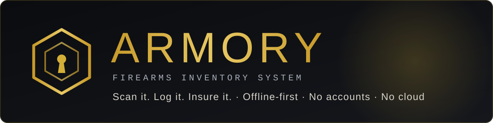
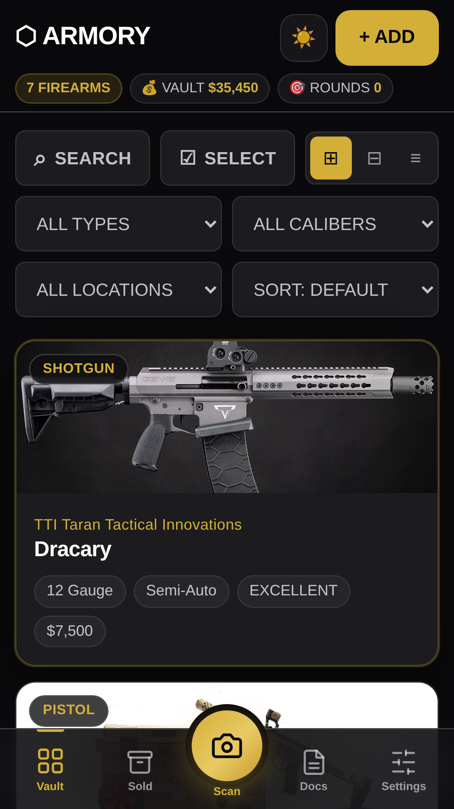
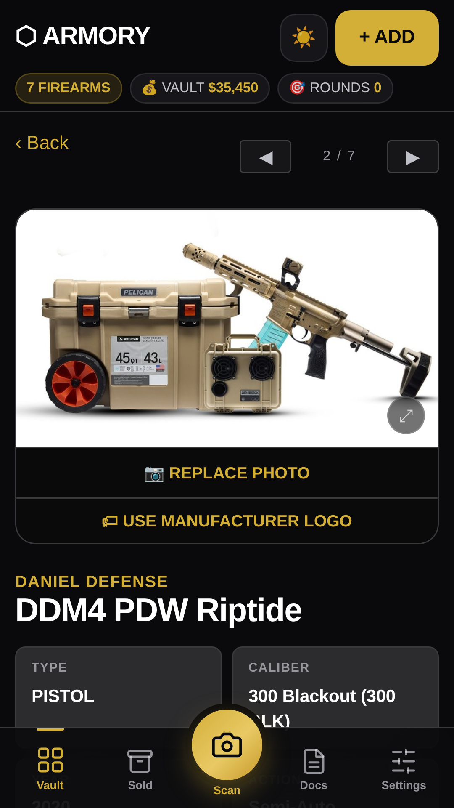
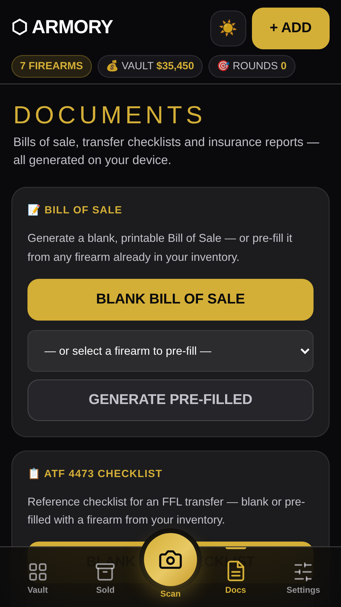
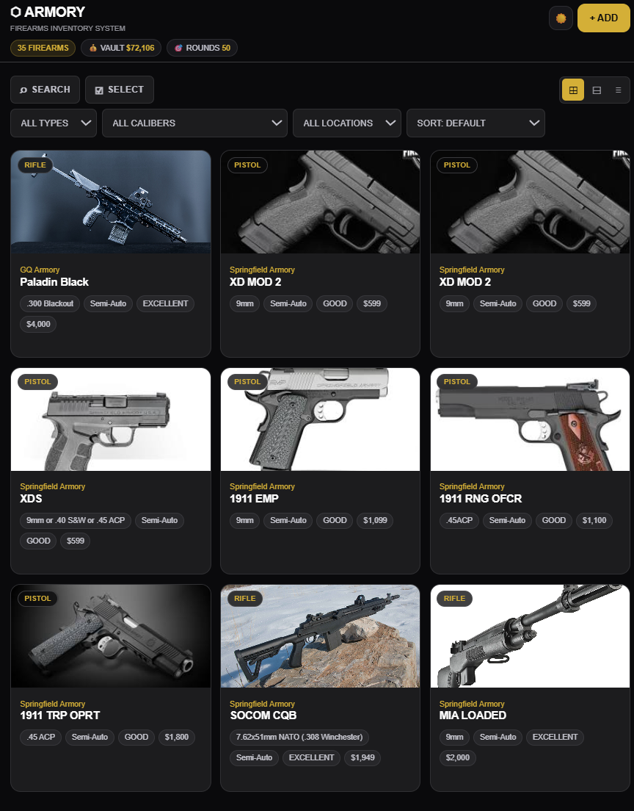
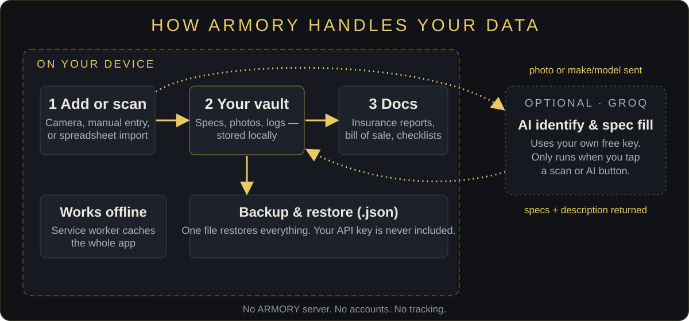

<div align="center">



**Private, offline-first firearms inventory. Scan it. Log it. Insure it.**

[**Landing page**](https://johnlaz.github.io/armory/) · [**Open the app**](https://johnlaz.github.io/armory/app/) · [Android APK](assets/ARMORY.apk)

</div>

---

## What it is

ARMORY is a Progressive Web App for cataloging a firearms collection. It installs on Android, iOS, Windows and macOS straight from the browser, runs offline, and keeps your data on your device. There are no accounts and no ARMORY servers.

<p align="center">
  
  
  
</p>
<p align="center"><sub><b>Vault</b> · <b>Detail</b> · <b>Docs</b> — phone screens show the built-in demo vault.</sub></p>

<p align="center">
  
</p>
<p align="center"><sub><b>A full vault</b> — 35 firearms, live totals, filters and sorting. Serial numbers are hidden in this screenshot.</sub></p>

**Features**

- **Vault** — grid, tile and list views; search, filter by type / caliber / location, and ten sort orders; live firearm count, vault value and rounds fired.
- **Scan** — point the camera at a firearm and vision AI proposes make, model and caliber. *AI fill* completes the spec sheet from make and model.
- **Records** — full spec sheet, hero photo plus gallery, range log, maintenance checklist and log, accessories, storage location, notes.
- **Docs** — insurance reports (single firearm or whole vault), blank or pre-filled Bill of Sale, and an ATF 4473 reference checklist. Reports open as print-ready pages; save them as PDF from the print dialog.
- **Sold archive** — retire a firearm from the vault and keep its record.
- **Import / export** — spreadsheet import (XLSX / CSV), Excel / CSV export, and a full JSON backup with merge or replace restore, and an **offline copy** (see changelog 3.2.0).
- **Demo vault** — seven sample firearms with photos load into an empty vault, and can be re-added any time from *Settings → Vault tools*.

## Live URLs

| | |
|---|---|
| Landing page | <https://johnlaz.github.io/armory/> |
| App | <https://johnlaz.github.io/armory/app/> |
| Android APK | <https://johnlaz.github.io/armory/assets/ARMORY.apk> |

## Repo layout

```
/index.html            landing page (installed-app launches redirect to /app/)
/README.md
/sw.js                 transitional worker — retires the pre-/app registration, then removes itself
/docs/                 README visuals only (banner.svg, how-it-works.svg, vault-full.png)
/assets/ARMORY.apk     Android wrapper (Trusted Web Activity)
/app/index.html        the whole app — one file
/app/manifest.json
/app/sw.js
/app/icon-192.png      192 + 512, maskable-safe
/app/icon-512.png
/app/icon-tile.png     cropped logo used by the landing page
/app/shot-*.png        manifest screenshots (phone ×3, desktop ×1)
/app/demo/*.jpg        demo-vault photos
/app/vendor/           xlsx.full.min.js (SheetJS 0.18.5, bundled so import/export work offline)
```

> `/sw.js` only exists so installs made before the move to `/app/` upgrade cleanly. It can be deleted after a few months.

## AI and model setup

AI features are optional and use **your own free [Groq](https://console.groq.com/keys) API key**.

1. Open **Settings → AI assistant** and paste a key (starts with `gsk_`) — it saves automatically.
2. The model list is pulled live from Groq when you save the key and whenever you tap 🔄.

How the model picker behaves:

- It **merges** — models Groq currently serves are added to the three built-in choices; nothing is removed.
- Your saved model is **never swapped automatically**. If Groq stops listing it, it stays selected and is flagged with ⚠.
- Non-chat models (speech, TTS, guard and safeguard classifiers, embeddings) are filtered out.
- If a call hits a rate limit or a retired model, the app tries the other available models for that request without changing your saved choice.

Default text model: `openai/gpt-oss-120b`. Camera identification picks a vision-capable model from the live list.

## Data and privacy



- Inventory, photos, logs, notes and settings are stored in your browser's **localStorage** on your device. There is no sync and no account.
- When you use a **scan** or **AI fill**, the photo or the make/model you entered is sent to **Groq**, using your key, and the answer comes back. Nothing is sent unless you use an AI feature.
- Your API key is stored locally, sent only to Groq, and **never included in backups**. Re-enter it after restoring on a new device.
- Records live in `localStorage` (about 5 million characters, plenty for thousands of firearms); photos and attached documents live in IndexedDB, limited by free disk space. The *Settings* home screen shows both.
- Clearing site data or uninstalling the app erases your vault. **Export a backup regularly.**
- All GitHub Pages apps on `johnlaz.github.io` share one browser origin, so a stored key is visible to other apps on that origin. Keys are namespaced (`armory_*`) so they do not collide.

## Deploy and update

Hosted on GitHub Pages from the repository root (`main`, `/ (root)`). There is no build step.

To ship a change:

1. Edit `/app/index.html`.
2. Bump `APP_VERSION` near the top of its main script. That one constant updates the on-screen version, the backup format version and the service-worker cache name (the app registers `sw.js?v=<version>`).
3. If you add or remove files the app needs offline, update the `SHELL` list in `/app/sw.js`. Every listed file must exist — install fails if one is missing.
4. Commit and push. Open installs fetch the new HTML first (network-first) and show an **ARMORY was updated — Reload** banner.

**Installs and the APK.** The manifest `id` is pinned to `/armory/index.html` so installs made before the `/app/` move keep their identity. Old installs launch the landing page, which sends standalone launches to `/app/`. The APK opens the app inside the same scope (`/armory/`), so it should keep working; if it does not, rebuild it with start URL `https://johnlaz.github.io/armory/app/index.html`.

## Changelog

### 3.3.0
- **Photos moved to IndexedDB.** Browsers cap `localStorage` at about 5 million characters per site, and photos stored as text filled it with a few dozen firearms. Records, settings and notes stay in `localStorage`; every large photo, gallery image and attached document now lives in IndexedDB, limited by free disk space instead. A 60-firearm vault with 24 million characters of photos saved and reloaded identically in testing, where the old limit was about 5 million.
- **Automatic, one-time migration:** the first launch of 3.3.0 moves existing inline photos into IndexedDB. Photos are written first and the record list is switched over only after they are safely stored, so an interrupted migration leaves the old data intact. Unused photos are cleaned up on launch.
- **Saves never fail silently.** If storage is full or a write fails, a message stays on screen and says the last change was not saved. (Before, a full `localStorage` made the save throw with no visible message.)
- **Storage meter is accurate:** shows records against the real record limit plus photo usage and free space on the device. The app also asks the browser to keep its storage persistent.
- Offline copies load their vault through the same path, so large baked vaults no longer risk the 5 MB limit when first opened. Backups (`.json`) and offline copies still contain full images.
- If IndexedDB is unavailable (some private modes), ARMORY falls back to the old everything-in-`localStorage` behavior.

### 3.2.0
- **Offline copy ("bake"):** *Settings → Backup & offline copy → Bake offline copy* writes one self-contained `.html` — the app, the Excel library, the demo photos and your whole vault (firearms, photos, range logs, maintenance, sold records, notes) all inlined. Open it in any browser with no internet and no install; on first open it loads the baked vault into that browser's storage. Opening a newer offline copy on a browser that already has a vault asks before replacing it. Restore also accepts an offline copy (`.json` or `.html`).
- **Settings redesign:** the four tabs and collapsible sections are replaced by a simple list — AI assistant · Backup & offline copy · Spreadsheets · Vault tools · About & help — each opening its own page with a back button. Hardware Back climbs one level first. The key and model save automatically (no Save button); the list shows live status such as the saved key and last backup date.
- **Backups now include sold records** (they were missing from the JSON backup); restore handles them in merge and replace.
- **Fix:** the About text claimed backups included the API key; they never do.

### 3.1.0
- **Navigation:** new bottom bar — Vault · Sold · Scan · Docs · Settings. Docs is now a screen; the header keeps only the theme toggle and **+ ADD**.
- **Back button:** Back never exits by accident. It closes the top-most layer first (prompt → photo viewer → guide → dialog → select mode → search), then returns any sub-screen to the Vault. At the Vault a second Back within 2.5 s is required to leave. Backing out of an edited firearm form asks *Discard changes?* first. Esc does the same on desktop.
- **Themes:** fixed unreadable text in both themes — hint and label text now meets WCAG AA (4.5:1) on every screen, dialog, toast and banner; gold text uses a darker bronze in light mode; dropdowns and their option lists follow the app theme on every platform; the status bar colour follows the theme.
- **Dialogs and notifications:** prompts, dialogs and photo viewers now cover the header and bottom nav (they used to sit underneath them); toasts always float above everything.
- **Fix:** closing the camera no longer throws a stack-overflow error (present since 3.0).
- **Settings:** four tabs (AI, Data, Manage, About) with collapsible sections; storage meter; API status moved into the AI tab.
- **Demo vault:** photos are bundled locally (no hot-linking); *Restore Demo Vault* added; old hot-linked demo photos migrate automatically.
- **Fix:** removed a hidden loader that replaced the whole inventory with sample data when it held three or fewer firearms without photos.
- **Privacy:** backups no longer include the API key.
- **Models:** refresh merges with the existing list; saved model kept and flagged, never auto-swapped.
- **Offline:** service worker precaches the app shell; SheetJS bundled locally; update banner; cache name follows `APP_VERSION`.
- **Manifest:** explicit `id`, maskable-safe 192 / 512 icons, working *Add* and *Scan* shortcuts, real screenshots.
- **Exports:** photos resolve correctly inside print windows.
- **Repo:** landing page and app merged into one repo (landing at root, app in `/app`); landing rebuilt with real screenshots and corrected privacy copy.

### 3.0
- Initial public release.

---

<div align="center">

© 2026 LAZLAB Creations. All Rights Reserved. · [lazlab.io@gmail.com](mailto:lazlab.io@gmail.com)

</div>
