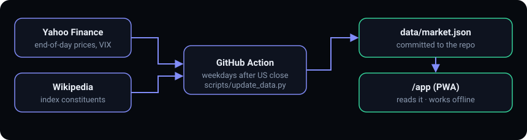

# Market Stretch Terminal

End-of-day overbought / oversold monitor for the Nasdaq-100 (QQQM), S&P 500 (SPY) and Dow (DIA).
One check after the close, one plain reading per index. No account, no API key. Not live: a GitHub Action rebuilds the data after each US close.

**Live:** https://johnlaz.github.io/mst/ (landing) · https://johnlaz.github.io/mst/app/ (app, installable as a PWA)



## What it does
- Shows whether each index is stretched down (oversold) or up (overbought), in plain words.
- Reads the Ultimate Oscillator, RSI, breadth (share of stocks above their 50 and 200-day averages), VIX, distance from the peak and moving averages, new highs/lows and volume.
- Three sensitivity levels (pullback ~8%, correction ~13%, bear market ~25% drop) instead of detailed criteria.
- Works offline with the last data it saw, and installs to a phone or desktop home screen.
- Screening aid only, not investment advice.

## Repo layout
```
/
├── index.html              landing page (no manifest, no service worker)
├── README.md
├── docs/
│   └── data-flow.svg       README visual
├── app/
│   ├── index.html          the whole app
│   ├── manifest.json
│   ├── sw.js               service worker (version must match the stamp in app/index.html)
│   ├── icon-192.png
│   ├── icon-512.png
│   └── apple-touch-icon.png
├── data/
│   └── market.json         built by the Action; do not edit by hand
├── scripts/
│   ├── update_data.py
│   └── requirements.txt
└── .github/workflows/
    └── update-data.yml     weekdays 22:30 UTC, after the US close
```
`data/` stays at the repo root. The app loads `data/market.json` and falls back to `../data/market.json`, which is where the Action writes it.

## AI / model setup
None. The app does not use an AI provider.

## Data & privacy
- Prices come from Yahoo Finance (via `yfinance`) and index constituents from Wikipedia. Both are unofficial sources and can change without notice.
- Settings and any manual entries are kept in your browser's local storage. Nothing is sent to a server of ours.
- An optional free FMP key, if you paste one into the app's Menu, is stored in your browser only and is never included in exports.

## Deploy / update
1. Settings → Pages → Source: Deploy from a branch → `main` / `/ (root)`.
2. Actions → "Update market data" → **Run workflow** (first run takes a few minutes and commits `data/market.json`).
3. If the run fails at the commit step: Settings → Actions → General → Workflow permissions → **Read and write permissions**.
4. To release an app change: edit `app/`, bump `VERSION` in `app/sw.js` **and** the version stamp in `app/index.html`, then push to `main`. Installed copies update on the next open.

Optional: repo secret `FMP_API_KEY`, used only as a last-resort backup source for the three index ETFs if Yahoo and Stooq both fail.

Base cases: the thresholds live in `PRESETS` near the top of the script in `app/index.html`. The "what followed past signals" table uses `PRESET_RULES` in `scripts/update_data.py`; keep the two in step.

## If something looks wrong
- Header says data is N days old: the Action failed or Yahoo blocked it that day. Check the Actions log and re-run.
- Site not updating after a successful run: confirm Pages is deploying from the branch the Action commits to.
- App looks stale after a release: reload once; the new service worker takes over on the next load.
- If Wikipedia's tables change, the script reuses the previous constituent list.
- Nasdaq-100 top-10 weight is approximate (market-cap share). S&P 500 weights are not computed.
- Without `data/market.json` the app falls back to manual entry (Update data menu).

## Changelog
- **1.0.0**: landing page at the repo root, app moved to `/app`, installable PWA (manifest, service worker, icons), version stamp, new README.

---
© 2026 LAZLAB Creations. All Rights Reserved. · lazlab.io@gmail.com
